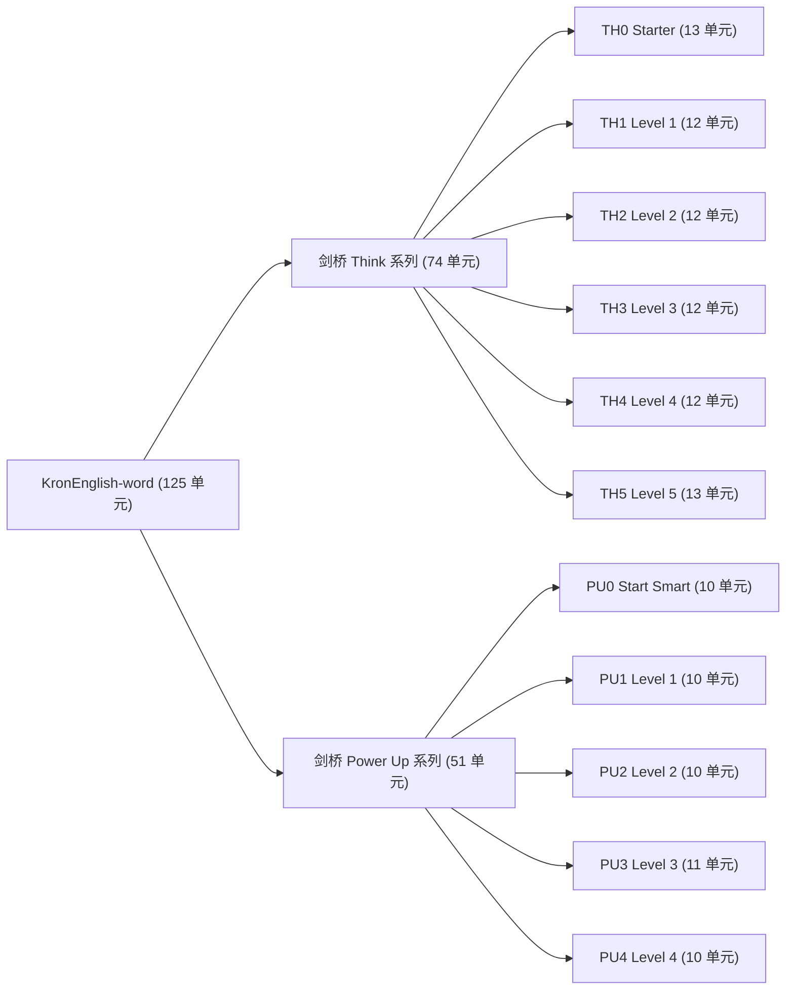

# KronEnglish-word ⚡ 触觉三维自然拼读词汇引擎

> **11 本权威剑桥教材 · 125 个沉浸式交互单元 · 2,577 核心词汇 · 100% 全拆分自然拼读**

KronEnglish-word 是基于 **Duolingo 3D 触觉质感**、**Blooket / Wordwall / Gimkit 游戏化引擎** 与 **全拆分自然拼读黄金法则 (Total Phonics & Morphemes)** 打造的独立词汇学习引擎系统。

---

## 🌟 核心特色与教研黄金法则

### 1. 全拆分自然拼读铁律 (Total Phonics Chunking)
- **单音节词 100% 拆解**：首音连缀（Onset: `pl-`, `gr-`, `str-`, `wr-`）+ 韵尾元音族（Rime: `-ay`, `-ass`, `-ield`, `-ite`）。
  - 例：`play` ➔ `['pl', 'ay']`、`grass` ➔ `['gr', 'ass']`、`field` ➔ `['f', 'ield']`、`lake` ➔ `['l', 'ake']`。
- **多音节词结构全解构**：前缀（Prefix）+ 词根（Root）+ 后缀（Suffix）。
  - 例：`instrument` ➔ `['in', 'stru', 'ment']`、`creative` ➔ `['cre', 'at', 'ive']`、`recycle` ➔ `['re', 'cy', 'cle']`。
- **复合短语逐词全拆**：
  - 例：`play an instrument` ➔ `['pl', 'ay', 'an', 'in', 'stru', 'ment']`。
  - 例：`take photos` ➔ `['t', 'ake', 'ph', 'o', 'tos']`。

### 2. 100% 举一反三同构咬合 (Homomorphism)
- 下方 Transfers 拓展卡中高亮的字母/词缀（`hl`），必须**在上方积木槽中找到 100% 一模一样的发音积木**。
- 拼完 `pl` + `ay`，下方高亮 `pl`（`player` 玩家, `plant` 植物）与 `ay`（`day` 白天, `stay` 停留），心智模型瞬间打通。

### 3. 三大 3D 游戏化学习引擎轮动
- 🎮 **Blooket 3D 开箱神偷**：积木通关后进入开箱夺金模式，解锁黄金宝箱与防盗窃护盾。
- ⚡ **Wordwall 3D 街机狂飙**：限时竞速连击，沉浸式音效与震颤打击感。
- 🛡️ **Gimkit 3D 护盾争霸**：答题赚取能量资产，购买多重防御与能量倍增器。

### 4. Aha! 生词本双向联动
- 实时监听 `localStorage` 与 `BroadcastChannel ('kron_ecosystem_bridge')`。
- 课上收藏的单词（如 `instrument`、`play`）在打开对应单元时自动识别，点亮 **⭐ 生词本重点** 金星勋章，并优先注入关卡。

---

## 📚 教材体系与覆盖清单 (11 本教材 · 125 单元)



---

## 🚀 极速启动与使用

### 1. 运行本地控制台
本项目无需任何重量级 Node 依赖，内置零依赖 Python 静态服务器：

```bash
# 启动本地开发与控制台门户
python3 server.py
# 或使用 npm
npm start
```

启动后在浏览器打开：
👉 **http://localhost:8080** 即可进入全新视觉的中央控制台，浏览与体验全部 125 个单元！

### 2. 自动化质量审计
运行严苛校验脚本，检查 125 个单元的全拆分达标率与同构咬合率：

```bash
python3 scripts/audit_all_words.py
```
> 输出结果：`🧩 Uncut words (> 2 chars): 0`，`🎯 Transfer hl mismatches: 0`，`🌟 100% GOLD STANDARD COMPLIANCE ACHIEVED!`

### 3. 数据重编与全量重构
如果修改了数据源，一键重新编译与全拆分精修：
```bash
python3 scripts/compile_all_books.py
python3 scripts/refine_all_words.py
```

---

## 📁 目录结构

```
KronEnglish-word/
├── public/
│   └── word/                 # 125 个生产就绪的独立 HTML 学习单元
│       ├── th0-welcome-word.html ... th0-12-word.html
│       ├── th1-1-word.html ... th1-12-word.html
│       ├── th2-1-word.html ... th2-12-word.html
│       ├── th3-1-word.html ... th3-12-word.html
│       ├── th4-1-word.html ... th4-12-word.html
│       ├── th5-welcome-word.html ... th5-12-word.html
│       ├── pu0-welcome-word.html ... pu0-9-word.html
│       ├── pu1-welcome-word.html ... pu1-9-word.html
│       ├── pu2-welcome-word.html ... pu2-9-word.html
│       ├── pu3-welcome-word.html ... pu3-9-word.html
│       └── pu4-welcome-word.html ... pu4-9-word.html
├── data/                     # 完整 11 本书底层词汇、短语与音标数据库
├── scripts/
│   ├── compile_all_books.py  # 全自动生产构建流水线
│   ├── refine_all_words.py   # 全拆分自然拼读规范化处理器
│   └── audit_all_words.py    # 100% 规范化自动化质量检测器
├── manifest.json             # 125 单元元数据汇总
├── index.html                # 现代化桌面/移动端交互式中央控制台
├── server.py                 # 极速轻量预览服务器
└── package.json
```
